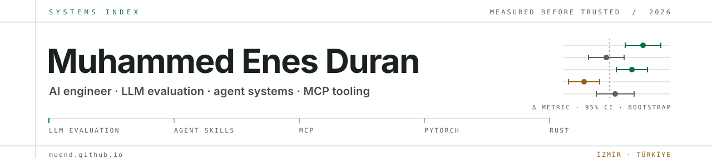
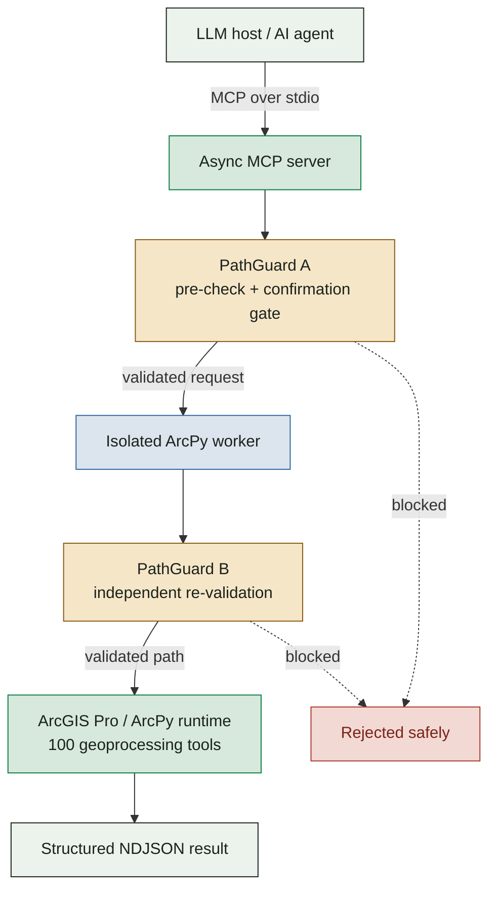

  <picture>
    <source media="(prefers-color-scheme: dark)" srcset="./assets/banner-dark.svg">
    
  </picture>

  
  
  
  
  

I am an AI engineer. I build **LLM evaluation platforms, agent systems and the tooling around them**: benchmarks with human-adjudicated gold labels and release gates, standards-driven Agent Skills, and MCP servers that give an agent real tools without handing it the runtime.

Most recently, as a contract AI engineer, I built a production LLM evaluation platform (a 923-case benchmark with human-adjudicated gold labels, bootstrap confidence intervals and release gates), and wrote a character-level GPT from a single neuron up in [neuron-to-gpt](https://github.com/muend/neuron-to-gpt). My degree is in city and regional planning, which is why much of my open-source agent tooling was first built for geospatial work.

The through-line is evidence. Every number below comes from a benchmark, a manifest or a released artifact in the repo it describes or, for client work, from the engagement's own records. Where a result does not exist yet, the repo says so instead of implying one.

  
  
  
  
  

---

## Experience

**AI Engineer (Contract) · EatBetter, AI-powered nutrition app · Sep 2026** · [case study](https://muend.github.io/projects/eatbetter.html)

- **Evaluation platform.** Built a 923-case benchmark from scratch: 569 human-adjudicated gold labels, a 277-case sealed holdout, 16 deterministic metrics and 742 automated tests in CI. Comparisons use user-clustered bootstrap CIs, and the release gate counts missing evidence as a failure.
- **Model decisions by measurement.** Retired a 7× costlier model after showing no gain (ΔF1 −0.006, 95% CI [−0.023, +0.012]) and shut down a candidate pipeline that lost to the bare model in 4 of 4 comparisons.
- **Assistant safety.** On a frozen 400-case scorecard, a fix for users with long memory profiles cut the missed-allergy-context veto rate from 96.4% to 2.1%, the only one of ten candidates to pass the gate.
- **Production data quality.** In a live PostgreSQL catalog of about 387k rows, soft-deleted 88,970 and unpublished 90,735, each write rehearsed as a ROLLBACK against a predicted row count before a human-approved COMMIT.

**Undergraduate Researcher · TÜBİTAK 2209-A · 2026–2027.** Sentinel-2 crop classification with U-Net segmentation and spatially blocked validation, built on `sentinel-crop-pipeline`.

**Education.** B.Sc. City and Regional Planning, İzmir Institute of Technology (expected June 2027) · B.Sc. Management Information Systems, Istanbul University (concurrent second degree).

---

## Systems

| System | What it is | Status | Links |
|---|---|---|---|
| **benchfck** | Deterministic evaluation generator and exact Rust harness for machine-state tasks | v0.4.0-alpha engineering candidate · no model results published | [Repo](https://github.com/muend/benchfck) · [Validity contract](https://github.com/muend/benchfck/blob/main/VALIDITY.md) |
| **neuron-to-gpt** | Eight-week path from a single neuron to a character-level GPT, written from scratch | Public · 4.8M parameters trained on an A100 · val NLL 1.4723 on Shakespeare | [Repo](https://github.com/muend/neuron-to-gpt) · [Week 8 results](https://github.com/muend/neuron-to-gpt/tree/main/week08) |
| **geoai-skills** | 18 Agent Skills covering the geospatial lifecycle, routed by an orchestrator | v0.4.0 · MIT · routing benchmarked 2026-08-05 | [Repo](https://github.com/muend/geoai-skills) · [Benchmark](https://github.com/muend/geoai-skills/blob/main/BENCHMARK.md) |
| **arcgis-mcp-bridge** | MCP server exposing 100 ArcGIS Pro / ArcPy geoprocessing tools to LLM hosts | Apache-2.0 · PyPI · Glama A-rated | [Repo](https://github.com/muend/arcgis-mcp-bridge) · [PyPI](https://pypi.org/project/arcgis-mcp-bridge/) · [Glama](https://glama.ai/mcp/servers/muend/arcgis-mcp-bridge) |
| **Pixel LLM** | Godot game that walks the player through building a language model in 10 stages, from data collection to launch | In development · private repo | [Project page](https://muend.github.io/projects/pixel-llm.html) |
| **PlaceTwin** | 3D digital twin and studio panel for two urban-design sites in Ayvalık, with a tool-calling Claude assistant grounded in the twin's data | In use by a university design studio · private repo | [Project page](https://muend.github.io/projects/placetwin.html) |
| **FOUNDER.EXE** | Startup simulation encoding Turkish and US tax, grant, SAFE and cap-table rules | Published · Windows x64 · paid | [itch.io](https://muend.itch.io/founderexe) |
| **sentinel-crop-pipeline** | Reproducible Sentinel-2 preparation: discover, mask, patch, label | v0.3.2 · Apache-2.0 · PyPI · Zenodo DOI | [Repo](https://github.com/muend/sentinel-crop-pipeline) · [PyPI](https://pypi.org/project/sentinel-crop-pipeline/) · [DOI](https://doi.org/10.5281/zenodo.21284444) |
| **agri-dss** | Zero-backend spatial decision support across 5 districts and 147 neighborhoods in Western Antalya | Live | [tarimsalkoridor.online](https://tarimsalkoridor.online) · [Repo](https://github.com/muend/agri-dss) |

Research repos: [kutri-resilience-index](https://github.com/muend/kutri-resilience-index), an urban resilience composite indicator with a [DOI](https://doi.org/10.5281/zenodo.21030093) · [turkiye-housing-prices-pandemic](https://github.com/muend/turkiye-housing-prices-pandemic), inflation-adjusted HPI and spatial clustering · [agri-unet](https://github.com/muend/agri-unet), the downstream U-Net training track for `sentinel-crop-pipeline`.

---

## Measured, not asserted

`geoai-skills` ships a frozen routing benchmark instead of a claim about how well the skills "work". 167 cases, 18 skills, run 2026-08-05 on Claude Code `2.1.214` with `claude-sonnet-5`, against a paired control with the skills switched off.

| Arm | Precision | Recall | Full-route accuracy |
|---|--:|--:|--:|
| Skills enabled | 99.17% | 96.77% | 96.41% |
| Skills disabled (control) | n/a | 0% | 0% |

The control recorded zero activations across all 167 cases, which is what makes the treatment arm mean anything. The benchmark measures **routing**, not answer quality, and the repo states that boundary explicitly.

---

## One architecture, as a sample

`arcgis-mcp-bridge` has to give an agent real geoprocessing power while keeping a licensed GIS runtime out of the host process. Two isolated processes, two independent path validations, one refusal path.

---

## Working on now

- **Deterministic evaluation.** Exact generators, restricted verifiers, preregistered release gates, and a hard line between engineering evidence and model evidence.
- **Language models from first principles.** `neuron-to-gpt` builds a GPT up from one neuron with a measured six-stage comparison; Pixel LLM turns the same pipeline into a game.
- **Agent systems.** Turning tacit expert practice into portable agent instructions and guarded tools, then measuring whether the routing actually holds up.
- **Remote sensing ML.** Spatially blocked splits, patch-aligned ground truth, and segmentation experiments downstream of a pipeline that is reproducible first.

**Stack:** Python · TypeScript · Rust · PyTorch · FastAPI · PostgreSQL / PostGIS · MCP · Agent Skills · Docker · GeoPandas · Rasterio · ArcPy · PySAL

---

## Contact

Open to AI engineering work: LLM evaluation and evaluation design, agent systems, MCP infrastructure and applied machine learning. Available part-time now and full-time from July 2027.

**[Portfolio](https://muend.github.io)** ([Türkçe](https://muend.github.io/tr/)) · **[LinkedIn](https://www.linkedin.com/in/muhammed-enes-duran/)** · **[nsduraan@gmail.com](mailto:nsduraan@gmail.com)**

  
  
  
  
  
  

